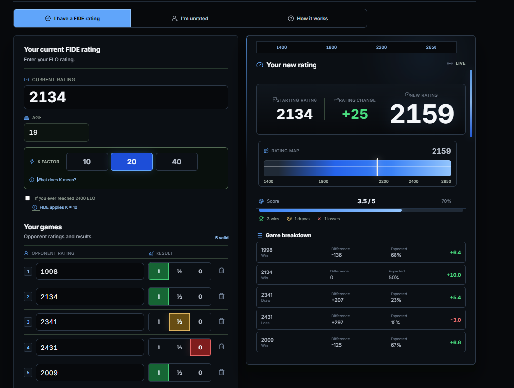

# FIDE Rating Calculator

An open-source, independent web tool for chess players and arbiters to estimate FIDE rating changes and initial ratings.

> This tool is independent and is not an official FIDE service.



## Use the calculator

[Open the FIDE Rating Calculator repository](https://github.com/zetachess/FIDE-Rating-Calculator)

## Live demo

The public deployment URL will be added here once the Vercel URL is confirmed.

## What it does

- Calculates rating changes for players who already have a FIDE rating.
- Estimates an initial rating for unrated players.
- Supports multiple opponents and game results.
- Shows expected scores, rating progression and a game-by-game breakdown.
- Includes the FIDE lookup tables used by the calculation engine.
- Provides English and Spanish interfaces.

## Who it is for

- Chess arbiters checking rating calculations.
- Players estimating the impact of their results.
- Tournament organizers reviewing rating changes.
- Developers and chess communities who want a transparent calculator.

## Important disclaimer

This tool is independent and is not an official FIDE service.

The calculations are based on the FIDE Rating Regulations, but this project does not publish official ratings, replace FIDE systems, or represent FIDE. For formal decisions, always consult the latest [FIDE Rating Regulations](https://handbook.fide.com/chapter/B022024) and official rating lists.

## Open source

This is an open-source project created independently for the chess community. Contributions, suggestions, bug reports and pull requests are welcome.

## Local development

```bash
git clone https://github.com/zetachess/FIDE-Rating-Calculator.git
cd FIDE-Rating-Calculator
pnpm install
pnpm dev
```

Useful commands:

```bash
pnpm test
pnpm lint
pnpm build
```

## Privacy

Calculations run in the browser. The app may store calculator state in the browser's local storage so that input can be restored during a later visit. No FIDE account or login is required.

## Contributing

1. Create a focused branch.
2. Add or update tests when changing calculation logic.
3. Run the test, lint and build commands.
4. Keep FIDE-related claims tied to the current official regulations.
5. Open a pull request with a clear description of the change.

## Technology

React, TypeScript, Vite, Recharts, Lucide React, Country Flag Icons and Vercel Analytics.

## License

Released under the [MIT License](LICENSE).

## Acknowledgements

FIDE names, regulations and official rating data belong to their respective owners. This project is an independent community tool.
